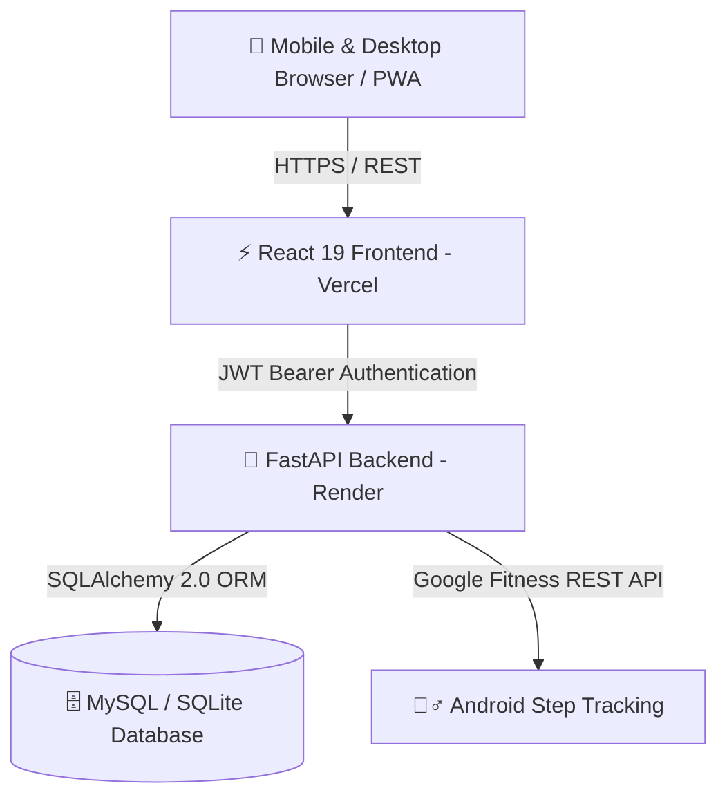

# 🏋️‍♂️ LAKSH — Full-Stack Gym Workout & Fitness Tracker

**LAKSH** is an all-in-one gym workout logger and personal fitness platform designed for athletes, lifters, and fitness enthusiasts. Track sets, reps, tonnage, hydration, daily step goals, and personal records with zero friction.

---

## 🏛️ System Architecture

---

## ✨ Features at a Glance

- **⚡ Live Workout Mode**: Real-time elapsed stopwatch, rest intervals with audible cue, and plate calculator.
- **📊 Interactive Analytics**: Volume load trends, workout frequency breakdown, and muscle group split charts powered by Recharts.
- **🏆 Personal Records (PRs)**: Automated calculation and detection of Weight PRs and Rep PRs.
- **💧 Smart Hydration**: Quick-log buttons (+250ml, +500ml), daily targets, and visual progress tracking.
- **👟 Daily Steps & Activity**: Integrated step counter with calorie and distance estimations.
- **📱 PWA & Offline Support**: Installable mobile app feel with responsive layout for phone and desktop.

---

## 🚀 Quick Start

### 1-Click Launch (Windows)
Double-click `start_laksh.bat` in the `fitlog` folder to launch both servers simultaneously:
- **Frontend**: [http://localhost:5173](http://localhost:5173)
- **Backend API & Swagger Docs**: [http://localhost:8000/docs](http://localhost:8000/docs)
